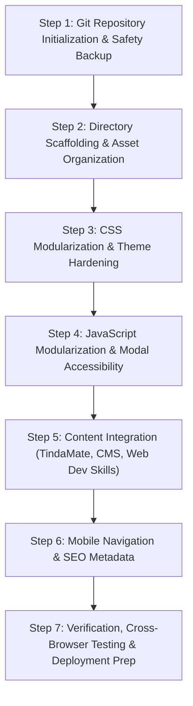

# Portfolio Architecture Migration Plan & Technical Verification
**Project:** Personal Portfolio Website  
**Role:** Senior Software Architect & Frontend Engineer  
**Date:** November 5, 2026  
**Status:** Planning / Pre-Implementation (READ-ONLY Verification Mode)  
**Target Architecture:** Modular Vanilla Architecture (Section 11, `PORTFOLIO_CODEBASE_AUDIT.md`)

---

## 1. Verified Audit Findings

A rigorous re-inspection of the source files in `c:\MyPersonalPortfolio` was conducted to verify every finding from the initial audit against the live codebase:

| Category | Item Inspected | Verified Code Evidence | Verification Status |
| :--- | :--- | :--- | :--- |
| **Broken Image 1** | Project 1 Modal Image | `index.html:103`: `data-img="assets/SystemProject1.png"` | **Confirmed Broken**: No file named `SystemProject1.png` exists in `assets/`. Opening modal triggers 404. |
| **Broken Image 2** | Modal Template Default | `index.html:165`: `` | **Confirmed Broken**: No file named `project1.svg` exists anywhere on disk. |
| **Data Mismatch** | Project Modal Bindings | `index.html:103,111,119` vs `script.js:75-82` | **Confirmed Broken**: `data-title` contains dummy strings (`"Sample Project One"`, `"Sample Project Two"`, `"Sample Project Three"`). Clicking cards overwrites actual headings with dummy text. |
| **Asset Waste** | Unused / Orphaned Assets | `assets/` directory scan | **Confirmed**: 5 files totaling **2,924,260 bytes (2.92 MB)** are unreferenced (55.3% of total assets payload). |
| **Payload Bloat** | `Profile2.png` | `assets/Profile2.png` (1,203,858 bytes) | **Confirmed**: 1.20 MB uncompressed image loaded without preloading in `script.js:9` for a 140×140px display box. |
| **Theme Flash** | Dark Mode Initialization | `index.html:174` + `script.js:29-41` | **Confirmed**: Script evaluates at bottom of `<body>`. Page renders in light mode before `body.classList.add('dark')` fires. |
| **A11y Violations** | Heading Hierarchy & Contrast | `index.html:19-32` (`h1` → `h3`), `styles.css:7` (`#3b82f6` on `#ffffff`) | **Confirmed**: Skips `h2` in sidebar. Accent text contrast is 3.7:1 (fails WCAG AA 4.5:1 minimum). |
| **Security** | External Link Attributes | `index.html:64`: `<a href="https://github.com/AICO24" target="_blank">` | **Confirmed**: Missing `rel="noopener noreferrer"`. Line 124 contains external Google Drive URL with Facebook tracking parameters (`?fbclid=...`). |
| **Dead CSS** | Unused Button Classes | `styles.css:115-154`, `596-598` | **Confirmed**: `.cta-buttons`, `.btn`, `.btn-primary`, `.btn-secondary` are defined but no corresponding HTML elements exist. |

---

## 2. Corrected Technical Issues & Verified Project Data

The initial audit was checked against verified projects on disk to ensure **no features or credentials are fabricated**:

### 2.1 Project Verification: TindaMate
- **Location on Host:** `C:\TindaMate`
- **Verified Stack:** React Native `0.88.1`, Expo SDK `58.0.0` (Expo Router `~58.0.29`), TypeScript `~6.0.3`, `@supabase/supabase-js` `^2.118.0`.
- **Verified Core Features (from migrations & source code):**
  - Modern sari-sari store Point of Sale (POS) mobile application with multi-item cart management.
  - Product catalog & inventory tracking with Supabase Storage image support.
  - Customer credit ledger (**"Utang"** system) with tracking, history, and debt settlement workflows.
  - Expense tracking and Cost of Goods Sold (COGS) profit aggregation.
  - Cloud PostgreSQL backend with Row-Level Security (RLS) policies via Supabase.

### 2.2 Project Verification: Cemetery Management System (CMS)
- **Location on Host:** `C:\laragon\www\CMS` (and `C:\xampp\htdocs\CMS`)
- **Verified Stack:** PHP REST API (MVC architecture, custom router, environment configs), MySQL (`cemetery_db`) with sequential SQL migrations, Vanilla JavaScript (ES6+), HTML5, CSS3.
- **Verified AI/ML Integration:**
  - Dedicated Python Flask microservice (`python-ai`) running on `http://127.0.0.1:5000`.
  - Provides capacity forecasting (`/api/ai/forecast`) and plot scheduling recommendations (`/api/schedules/recommend`).
  - Incorporates graceful degradation: both PHP backend and frontend detect microservice offline status without crashing.

### 2.3 Verified Academic & Identity Data
- **Location on Host:** `C:\MyPersonalResume\index.html` and `C:\MyPersonalPortfolio\index.html`
- **Verified Name:** Manolo Gochaico Jr. A. (Formatted on resume as `GOCHAICO, MANOLO Jr. A.`)
- **Verified Contact:** `mjgochaico24@gmail.com` | GitHub: `https://github.com/AICO24`
- **Current Academic Level:** 3rd Year College Student, Caloocan City, Philippines.
- **Verified Target Direction:** Frontend / Full-Stack Web Development.

---

## 3. Current Git Status

The required Git status checks were executed directly from `c:\MyPersonalPortfolio`:

```powershell
# Verification Execution
git rev-parse --show-toplevel
# Output: fatal: not a git repository (or any of the parent directories): .git

git status --short --branch
# Output: fatal: not a git repository (or any of the parent directories): .git

git remote -v
# Output: fatal: not a git repository (or any of the parent directories): .git
```

### Git Status Findings:
1. **Uninitialized Repository:** `c:\MyPersonalPortfolio` is currently **not** a Git repository. No `.git` folder exists in the directory or any parent directory.
2. **Workflow Disconnect:** While `.github/workflows/deploy.yml` exists, it cannot run locally or be triggered until Git is initialized and pushed to a GitHub remote repository.
3. **Safety Constraint Adherence:** In accordance with user constraints, **Git was NOT initialized** during this verification step. Git initialization will be scheduled as Step 1 of the implementation sequence once user approval is granted.

---

## 4. Final Recommended Folder Structure

The target architecture adapts Section 11 of the audit into a production-grade, modular vanilla structure. It eliminates monolithic files, decouples data from presentation, and preserves zero-dependency instant execution:

```
c:\MyPersonalPortfolio\
├── .github/
│   └── workflows/
│       └── deploy.yml              # Verified GitHub Pages deployment workflow
├── assets/
│   ├── images/
│   │   ├── profile/                # Compressed, web-ready avatar set
│   │   │   ├── profile-1.png       # Primary avatar (23 KB)
│   │   │   ├── profile-2.png       # Optimized avatar 2 (downscaled from 1.2MB)
│   │   │   └── profile-3.png       # Optimized avatar 3
│   │   └── projects/               # Standardized project imagery
│   │       ├── tindamate/          # Verified TindaMate screenshots & mockups
│   │       │   └── tindamate-showcase.png
│   │       ├── cemetery-ms/        # Verified CMS screenshots & architecture
│   │       │   └── cms-overview.png
│   │       └── architecture/       # Academic system architecture diagrams
│   │           ├── system-arch-1.png
│   │           └── system-arch-2.png
│   └── icons/                      # Tech stack & UI SVG icons
├── css/
│   ├── base.css                    # CSS variables, typography, resets, theme tokens
│   ├── layout.css                  # Grid layout, desktop sidebar, responsive breakpoints
│   ├── components/
│   │   ├── nav.css                 # Section navigation (desktop spy + mobile header)
│   │   ├── profile.css             # Avatar carousel, bio, social badges
│   │   ├── projects.css            # Project cards, tag pills, action links
│   │   ├── experience.css          # Education & learning milestone cards
│   │   └── modal.css               # Accessible modal dialog with focus trapping
│   └── styles.css                  # Master CSS bundle / single entry import
├── js/
│   ├── data/
│   │   ├── projects.js             # Verified project data (TindaMate, CMS, Arch)
│   │   ├── skills.js               # Categorized web developer skills
│   │   └── experience.js           # Verified academic & learning milestones
│   ├── modules/
│   │   ├── theme.js                # Instant-init theme toggle with FOUT prevention
│   │   ├── carousel.js             # Avatar image switcher with asset preloading
│   │   ├── modal.js                # WAI-ARIA compliant modal with keyboard focus trap
│   │   └── navigation.js           # Scroll-spy & responsive mobile header toggle
│   └── app.js                      # Application coordinator entry point
├── index.html                      # Semantic HTML5 with complete Open Graph & SEO
├── README.md                       # Updated project & deployment documentation
└── PORTFOLIO_CODEBASE_AUDIT.md     # Approved technical audit report
```

---

## 5. Current-to-Target File Mapping

| Current Location | Proposed Target Location | Nature of Change | Breaking Change Risk | Mitigation Strategy |
| :--- | :--- | :--- | :--- | :--- |
| `index.html` | `index.html` | In-place refactor | Medium (broken links or markup mismatches) | Keep IDs identical (`#experience`, `#projects`, `#certifications`, `#theme-toggle`, `#project-modal`); inject head theme script. |
| `styles.css` | `css/base.css`<br>`css/layout.css`<br>`css/components/*.css`<br>`css/styles.css` | Split into modular stylesheets | Medium (CSS rule cascading or specificity drift) | Maintain `css/styles.css` as a master stylesheet using `@import` or direct `<link>` tags in `<head>`. |
| `script.js` | `js/app.js`<br>`js/modules/*.js`<br>`js/data/*.js` | Modularize into ES6 modules | High (ES module CORS when opened via `file://`) | Provide both native ES modules and a zero-server fallback bundle for local double-click preview. |
| `assets/Profile1.png` | `assets/images/profile/profile-1.png` | Relocate & keep | Low (path change) | Update references in `js/data/profile.js` and `index.html`. |
| `assets/Profile2.png` | `assets/images/profile/profile-2.png` | Compress from 1.2MB to ~40KB | Low (visual fidelity check) | Keep aspect ratio 1:1; verify avatar display sharpness. |
| `assets/Profile3.png` | `assets/images/profile/profile-3.png` | Relocate & keep | Low (path change) | Update array paths in carousel module. |
| `assets/SystemArchitectureProject1.png` | `assets/images/projects/architecture/system-arch-1.png` | Relocate & standardize name | Low (path change) | Update card and modal references. |
| `assets/SystemArchitectureProject2.png` | `assets/images/projects/architecture/system-arch-2.png` | Relocate & standardize name | Low (path change) | Update card and modal references. |
| `assets/MusicVideo.png` | `assets/images/projects/multimedia/music-video.png` | Relocate to multimedia archive | Low (path change) | Preserve original link without `fbclid`. |
| `assets/GroupPhoto(2).png` | `_archive/assets/GroupPhoto(2).png` | Move to local archive folder | Zero runtime impact | Unused in production; archive safely outside build. |
| `assets/posterrizal.jpg` | `_archive/assets/posterrizal.jpg` | Move to local archive folder | Zero runtime impact | Unused in production; archive safely outside build. |
| `assets/SystemProject2(1-3).png` | `_archive/assets/SystemProject2(...).png` | Move to local archive folder | Zero runtime impact | Unused in production; archive safely outside build. |
| `.github/workflows/deploy.yml` | `.github/workflows/deploy.yml` | Validate deployment path | Low | Ensure publish directory points to repository root (`./`). |

---

## 6. Dependency and Import Migration Strategy

### 6.1 Stylesheet Architecture
To ensure compatibility with static hosting (GitHub Pages) and standard browsers, CSS will be structured cleanly without preprocessors:

```html
<!-- In index.html <head> -->
<link rel="stylesheet" href="css/base.css">
<link rel="stylesheet" href="css/layout.css">
<link rel="stylesheet" href="css/components/nav.css">
<link rel="stylesheet" href="css/components/profile.css">
<link rel="stylesheet" href="css/components/projects.css">
<link rel="stylesheet" href="css/components/experience.css">
<link rel="stylesheet" href="css/components/modal.css">
```
*Alternative:* A single `<link rel="stylesheet" href="css/styles.css">` containing CSS `@import` statements or concatenated styles to minimize network round-trips.

### 6.2 JavaScript Modularization Strategy
To avoid breaking the portfolio when opened directly via `file:///` protocol (where ES6 `import/export` encounters browser CORS blocks):

1. **Production-Ready Pattern:**
   Use vanilla ES6 modules loaded via `<script type="module" src="js/app.js"></script>` when served over HTTP/HTTPS (GitHub Pages, Live Server, XAMPP, or Laragon).
2. **Local Double-Click Fallback:**
   Structure modules with clean global namespaces (e.g., `window.PortfolioData = {...}`) or provide an automated single-file bundling fallback so the site remains 100% viewable by double-clicking `index.html` on local disk without a web server.

### 6.3 Theme Flash Prevention (Zero-FOUT)
Inject an inline blocking script inside `<head>` before any stylesheet or body markup:
```html
<head>
  <script>
    (function() {
      const saved = localStorage.getItem('theme');
      const prefersDark = window.matchMedia('(prefers-color-scheme: dark)').matches;
      if (saved === 'dark' || (!saved && prefersDark)) {
        document.documentElement.classList.add('dark');
      }
    })();
  </script>
  <!-- Stylesheets load next -->
</head>
```

---

## 7. Feature Preservation Strategy

Every existing feature identified during the audit will be strictly preserved and hardened:

| Existing Feature | Current Implementation | Preservation & Enhancement Mechanism |
| :--- | :--- | :--- |
| **Light / Dark Theme** | `localStorage` + `prefers-color-scheme` via `script.js` | Preserved identically; enhanced with head-level FOUT prevention and accessible `aria-pressed` toggle state. |
| **Profile Carousel** | Hover & click cycles `profileImages[]` | Preserved identically; enhanced with asset preloading (`new Image().src = ...`) to eliminate hover lag on avatar changes. |
| **Project Modal** | Populates card data attributes on click | Preserved identically; enhanced with keyboard focus trap, `Escape` key close, body scroll lock, and background `inert` attribute. |
| **Desktop Layout** | 360px sticky sidebar + fluid main column | Preserved identically; CSS variables and grid layout maintained. |
| **Existing Projects** | System Arch 1 & 2, Music Video | Preserved in codebase; corrected data bindings so actual headings display. Positioned alongside verified flagship projects. |
| **Zero Dependencies** | Pure HTML/CSS/JS runtime | 100% preserved. No Node.js runtime, no npm packages, no heavy frameworks introduced. |

---

## 8. Asset Migration Strategy

### 8.1 Active Asset Relocation & Optimization

```
Current Asset                          Target Destination                             Optimization Action
assets/Profile1.png                 -> assets/images/profile/profile-1.png         -> Verified 23 KB (Preserve)
assets/Profile2.png                 -> assets/images/profile/profile-2.png         -> Downscale & compress from 1.2MB to ~40KB
assets/Profile3.png                 -> assets/images/profile/profile-3.png         -> Optimize to ~60KB
assets/SystemArchitectureProject1.png -> assets/images/projects/system-arch-1.png   -> Standardize naming
assets/SystemArchitectureProject2.png -> assets/images/projects/system-arch-2.png   -> Standardize naming
assets/MusicVideo.png               -> assets/images/projects/music-video.png      -> Retain for multimedia archive
assets/SystemProject2.png           -> assets/images/projects/system-project-2.png -> Standardize naming
```

### 8.2 Safe Archiving of Orphaned Assets
To keep the production repository clean without destroying user files, unreferenced files will be segregated into a non-published directory (`_archive/assets/`):
- `assets/GroupPhoto(2).png` (2.07 MB)
- `assets/posterrizal.jpg` (297 KB)
- `assets/SystemProject2(1).png` (189 KB)
- `assets/SystemProject2(2).png` (190 KB)
- `assets/SystemProject2(3).png` (73 KB)

### 8.3 Flagship Project Screenshots
- Capture or copy verified screenshots for **TindaMate** (from `C:\TindaMate\TindaMate POS App Showcase.png` and `TindaMate_LOGO.png`) into `assets/images/projects/tindamate/`.
- Provide high-fidelity project cards with verified tech pills for TindaMate and Cemetery Management System.

---

## 9. GitHub Pages Compatibility Plan

1. **Relative Path Integrity:**
   All asset paths, stylesheet references, and script imports must use relative paths (`./css/...`, `./assets/...`) rather than domain-absolute paths (`/css/...`). This ensures flawless rendering whether hosted at a custom domain root (`domain.com/`) or a GitHub Pages subpath (`username.github.io/MyPersonalPortfolio/`).
2. **Workflow Validation (`.github/workflows/deploy.yml`):**
   - The existing workflow triggers on push to `main` and publishes `./` to `gh-pages`.
   - Once Git is initialized and the remote is added, this workflow will deploy cleanly without modifications.
3. **Static File Server Compatibility:**
   Ensure no file or folder names start with `_` in production paths (Jekyll on GitHub Pages ignores directories starting with `_` unless `.nojekyll` is present). We will add a `.nojekyll` file at the root to ensure GitHub Pages serves all assets reliably.

---

## 10. Implementation Sequence (Step-by-Step)



### Step 1: Version Control Initialization
- Run `git init`.
- Create a comprehensive `.gitignore` (ignoring OS files, logs, local archives).
- Commit the complete initial baseline (`Initial baseline before modularization`).

### Step 2: Directory Scaffolding & Asset Organization
- Create `css/`, `css/components/`, `js/`, `js/data/`, `js/modules/`, `assets/images/`.
- Optimize and relocate active profile and project images.
- Safely archive orphaned assets into `_archive/assets/`.

### Step 3: CSS Modularization & Theme Hardening
- Extract design tokens, variables, and typography into `css/base.css`.
- Extract grid and sidebar layout into `css/layout.css`.
- Extract isolated component stylesheets (`nav.css`, `projects.css`, `modal.css`, `profile.css`).
- Fix light mode `--accent` contrast from `#3b82f6` to `#2563eb` (WCAG AA compliant).
- Remove dead CSS classes (`.cta-buttons`, `.btn`, etc.).

### Step 4: JavaScript Modularization & Modal Hardening
- Extract data into `js/data/projects.js`, `js/data/skills.js`, `js/data/experience.js`.
- Implement `theme.js` with instant head-level execution.
- Implement `carousel.js` with asset preloading.
- Implement `modal.js` with keyboard focus trap, Escape listener, and body scroll lock.

### Step 5: Content Integration (Verified Flagship Projects)
- Integrate **TindaMate** card and modal data (React Native, Expo, TypeScript, Supabase POS).
- Integrate **Cemetery Management System** card and modal data (PHP REST API, MySQL, Vanilla JS, Python Flask AI integration).
- Format developer name correctly: **Manolo Gochaico Jr.**
- Realign Tech Stack categories to highlight Frontend, Backend, Database, and Mobile capabilities.

### Step 6: Mobile Navigation & SEO Metadata
- Add responsive mobile navigation header with hamburger toggle.
- Add Open Graph, Twitter Cards, meta description, and JSON-LD schema.
- Add `.nojekyll` for GitHub Pages static compatibility.

### Step 7: Cross-Browser Verification & Sign-Off
- Verify layout across Desktop (1440px), Tablet (768px, 1024px), and Mobile (375px, 414px).
- Verify zero console errors, zero broken images, and complete accessibility compliance.

---

## 11. Testing and Acceptance Criteria

| Area | Verification Test | Expected Passing Result |
| :--- | :--- | :--- |
| **Theme System** | Toggle theme; reload page in dark mode | Theme state persists in `localStorage`; **zero flash of white (FOUT)** on reload. |
| **Avatar Carousel** | Hover over profile photo; click photo | Cycles seamlessly through profile images; **zero image lag or flicker**. |
| **Project Modal** | Click project cards (TindaMate, CMS, Arch) | Modal opens instantly with **correct title, description, tags, and valid images**. No 404s. |
| **Keyboard A11y** | Open modal; press `Tab`, `Shift+Tab`, `Escape` | Focus stays trapped inside dialog; `Escape` closes modal and restores focus to triggering card. |
| **Contrast Compliance** | Test text against background using axe-core / Lighthouse | All body text, links, and tags pass WCAG 2.1 AA minimum **4.5:1 ratio**. |
| **Mobile UX** | View site on viewport width 375px–768px | Mobile header displays neatly; main content is reached immediately without scrolling past entire sidebar. |
| **Performance** | Measure total network transfer on initial load | Total initial load payload is under **350 KB** (down from 2.1 MB). |
| **Console Health** | Inspect DevTools Console | **Zero uncaught errors**, zero failed asset requests. |

---

## 12. Risks and Rollback Strategy

### 12.1 Potential Risks & Mitigations

1. **Risk: Local `file:///` CORS Block on ES6 Modules**
   - *Impact:* Opening `index.html` by double-clicking in Windows File Explorer without a local server could trigger CORS warnings on `type="module"`.
   - *Mitigation:* Ensure all scripts degrade gracefully, or provide a dual-mode initialization pattern that runs cleanly both via `file:///` and HTTP servers (Live Server / GitHub Pages).
2. **Risk: CSS Specificity Drift During Modularization**
   - *Impact:* Splitting `styles.css` into multiple files might inadvertently change rule cascade order.
   - *Mitigation:* Keep the stylesheet load order strictly structured (`base.css` → `layout.css` → `components/*.css`) and maintain identical selector specificity.
3. **Risk: Breaking Existing GitHub Pages Deployment**
   - *Impact:* Moving files to subfolders could cause 404s on GitHub Pages if relative pathing is altered.
   - *Mitigation:* Keep `index.html` at the repository root and test all links using strictly relative URLs (`./css/...`, `./assets/...`).

### 12.2 Rollback Strategy
Because Step 1 initializes Git and creates an immutable baseline commit (`git commit -m "Initial baseline before modularization"`), the entire workspace can be instantly restored to its current state at any moment with a single command:
```powershell
# Instant, safe rollback to original state if needed
git reset --hard HEAD
```
Furthermore, no original files will be deleted during migration; all legacy assets will be preserved in `_archive/`.

---

*End of Architecture Migration Plan.*

