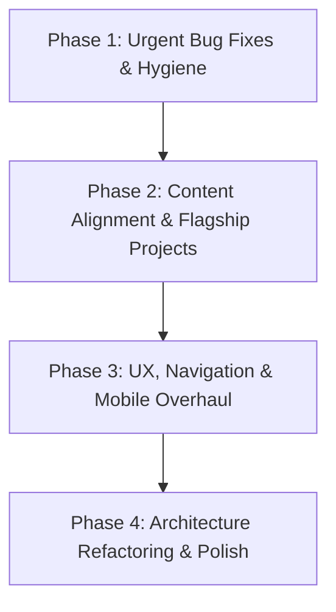

# Codebase Technical Audit & Architectural Assessment
**Project:** Personal Portfolio Website  
**Date:** November 5, 2026  
**Auditor:** Senior Full-Stack Developer, Software Architect, UI/UX Auditor & Code Quality Analyst  
**Scope:** Read-Only Codebase Audit (`c:\MyPersonalPortfolio`)

---

## 1. Executive Summary

This report delivers an exhaustive, read-only architectural, technical, UI/UX, responsiveness, performance, SEO, accessibility, and security audit of the existing personal portfolio website.

### High-Level Assessment
The current portfolio is a lightweight, static single-page website built with plain HTML5, vanilla CSS3, and vanilla JavaScript (ES6). It adopts a two-column sidebar layout inspired by the minimalist Bryl Lim design archetype.

While the foundation is clean and lightweight (no heavy third-party runtime frameworks or bloated libraries), the portfolio in its current state is an **early-stage academic template** with several significant technical defects, broken references, severe performance bottlenecks caused by unoptimized assets, accessibility compliance failures, and a critical mismatch with the owner's primary career trajectory: **Web Development**.

### Key Findings
1. **Critical Asset & Link Defects:** The modal defaults to a non-existent SVG asset (`assets/project1.svg`), the first project card references a non-existent image (`assets/SystemProject1.png`), and project modal titles display generic placeholder data (`"Sample Project One"`) rather than the actual project titles.
2. **Heavy Unoptimized & Orphaned Assets:** The repository contains ~4.87 MB of assets, of which **2.76 MB (56%)** consists of orphaned files never displayed on the site (`GroupPhoto(2).png`, `posterrizal.jpg`, `SystemProject2(1-3).png`). Furthermore, an avatar image (`Profile2.png`) is an uncompressed 1.20 MB PNG displayed inside a 140×140px container without preloading, inducing visual stutter and bandwidth waste.
3. **Disconnection from Web Development Career Goal:** The flagship projects mentioned in the project context—**TindaMate** (React Native, Expo, TypeScript, Supabase) and **Cemetery Management System** (PHP, MySQL, JavaScript, Python, AI/ML)—are **completely absent** from the codebase. The portfolio currently displays generic school architecture diagrams and a multimedia video link pointing to a personal Google Drive folder with Facebook tracking parameters.
4. **Missing Navigation & Flawed Mobile Architecture:** There is no `<nav>` element or table of contents. On mobile viewports (< 768px), the entire sidebar (profile, about, tech stack, social links, theme toggle) unpins and stacks *above* the main content, forcing mobile visitors to scroll past hundreds of pixels before seeing any experience or projects.
5. **Theme Flash (FOUT) & Incomplete Modal Accessibility:** The theme script executes after the DOM body renders, causing a noticeable flash of white when dark mode is enabled. The modal dialog lacks a focus trap, background scroll lock, and dynamic accessible labeling.

---

## 2. Existing Technology Stack

| Layer | Existing Implementation | Version / Details | Assessment |
| :--- | :--- | :--- | :--- |
| **Markup** | HTML5 | Standard static HTML (`index.html`) | Semantic elements used (`aside`, `main`, `section`, `article`), but missing `<nav>`, meta description, Open Graph, and JSON-LD. |
| **Styling** | Vanilla CSS3 | Custom CSS (`styles.css`) | Uses CSS custom properties for light/dark themes. Contains dead CSS and nested desktop scroll containers. |
| **Scripting** | Vanilla JavaScript | ES6+ (`script.js`) | Handles theme toggling, hover/click avatar carousel, and modal open/close. No build step or bundler. |
| **Typography** | Native System Fonts | `-apple-system, BlinkMacSystemFont, Segoe UI...` | Zero external font dependencies (zero network cost), but lacks modern developer brand character. |
| **CI / CD** | GitHub Actions | `.github/workflows/deploy.yml` | Configured to deploy to `gh-pages` via `peaceiris/actions-gh-pages@v3` with Node.js 18. **Repository is not currently a git repo.** |
| **Dependencies** | None | 0 npm packages, 0 CDN scripts | Clean runtime footprint, zero third-party vulnerability attack surface. |

---

## 3. Current Project Architecture

### 3.1 Directory & File Layout
```
c:\MyPersonalPortfolio\
├── .github/
│   └── workflows/
│       └── deploy.yml              # GitHub Actions Pages deployment workflow
├── assets/
│   ├── GroupPhoto(2).png           # 2,073,222 bytes (ORPHANED - not referenced)
│   ├── MusicVideo.png              #   102,957 bytes (Referenced in card 3 data-img)
│   ├── posterrizal.jpg             #   297,265 bytes (ORPHANED - not referenced)
│   ├── Profile1.png                #    23,465 bytes (Referenced in avatar carousel)
│   ├── Profile2.png                # 1,203,858 bytes (Referenced in avatar carousel - 1.2MB!)
│   ├── Profile3.png                #   317,491 bytes (Referenced in avatar carousel)
│   ├── ProjectAnimation&VideoEditing.png # 154,439 bytes (Referenced in card 3 img src)
│   ├── SystemArchitectureProject1.png    # 207,819 bytes (Referenced in card 1 img src)
│   ├── SystemArchitectureProject2.png    # 205,634 bytes (Referenced in card 2 img src)
│   ├── SystemProject2(1).png       #   189,692 bytes (ORPHANED - not referenced)
│   ├── SystemProject2(2).png       #   190,508 bytes (ORPHANED - not referenced)
│   ├── SystemProject2(3).png       #    73,573 bytes (ORPHANED - not referenced)
│   └── SystemProject2.png          #   249,270 bytes (Referenced in card 2 data-img)
├── index.html                      # 8,758 bytes (Single HTML document)
├── README.md                       # 4,762 bytes (Student portfolio documentation)
├── script.js                       # 3,989 bytes (Vanilla client script)
└── styles.css                      # 10,763 bytes (Single stylesheet)
```

### 3.2 Component & Logic Separation
- **`index.html`**: Monolithic structure containing both the sidebar content (profile, about, skills, social, theme switch) and the main feed (experience, projects, certifications, beyond coding), plus the modal dialog markup at the bottom.
- **`styles.css`**: Monolithic file containing global variables, layout grid, typography, sidebar rules, main content cards, modal styling, media queries, and scrollbars.
- **`script.js`**: Monolithic event handling script for avatar carousel, theme state handling via `localStorage`, and modal data-binding.
- **No Modularization:** No separation of data (e.g., JSON/JS configuration for projects, skills, and experience items) from presentation markup. Any update to projects or skills requires modifying raw HTML.

---

## 4. Architecture Issues and Recommendations

### Issue ARC-01: Broken Image References & Modal Data Mismatch
- **Affected File:** [`index.html`](file:///c:/MyPersonalPortfolio/index.html#L103-L165), [`script.js`](file:///c:/MyPersonalPortfolio/script.js#L74-L86)
- **Priority:** **Critical**
- **Description:**
  1. Card 1 specifies `data-img="assets/SystemProject1.png"`. This file **does not exist** on disk (only `SystemArchitectureProject1.png` exists). When the user clicks the card, the modal displays a broken image.
  2. The modal template default specifies `src="assets/project1.svg"`, which also **does not exist** on disk.
  3. Card 1 has `data-title="Sample Project One"` and `data-desc="A school project..."`, while its visible card heading is `<h3>System Architecture 1 Project</h3>`. When clicked, the modal overwrites the title with the generic placeholder `"Sample Project One"` instead of the actual project title.
- **Why It Matters:** Breaks user experience immediately upon clicking projects, exposing broken assets and dummy placeholder copy to recruiters and visitors.
- **Recommended Solution:** Correct all `data-img` attributes to valid file paths, remove default non-existent fallback images, and align data attributes directly with project content or dynamically derive modal text from card DOM elements.

---

### Issue ARC-02: Massive Unreferenced/Orphaned Assets in Deployment
- **Affected File:** `assets/` directory
- **Priority:** **High**
- **Description:**
  Over 2.76 MB of files in `assets/` are completely unused by the website:
  - `assets/GroupPhoto(2).png` (2.07 MB)
  - `assets/posterrizal.jpg` (297 KB)
  - `assets/SystemProject2(1).png` (189 KB)
  - `assets/SystemProject2(2).png` (190 KB)
  - `assets/SystemProject2(3).png` (73 KB)
- **Why It Matters:** Unnecessarily inflates the repository size, slows down git operations and CI/CD deployment pipelines, and creates confusion about what assets are actually in production.
- **Recommended Solution:** Audit asset folder, archive or delete unused files, and establish a standardized naming convention (lowercase, kebab-case, no spaces or special symbols like `(2)` or `&`).

---

### Issue ARC-03: Tight Coupling of Content and Presentation (Zero Data Abstraction)
- **Affected File:** [`index.html`](file:///c:/MyPersonalPortfolio/index.html#L33-L157)
- **Priority:** **Medium**
- **Description:**
  All project items, skills, experience milestones, and certifications are hardcoded directly into HTML tags. Adding or editing a project requires manually copying complex nested HTML cards and synchronizing multiple `data-*` attributes with inner child elements.
- **Why It Matters:** Scalability and maintainability are severely limited. Updating content frequently leads to syntax errors, mismatched closing tags, or broken modal bindings.
- **Recommended Solution:** Separate portfolio data into structured JavaScript modules/objects (e.g., `data/projects.js`, `data/skills.js`, `data/experience.js`) or establish a modern static generator/component architecture where markup is rendered dynamically or templated cleanly.

---

### Issue ARC-04: Git Repository Not Initialized Despite CI/CD Workflow
- **Affected File:** [`.github/workflows/deploy.yml`](file:///c:/MyPersonalPortfolio/.github/workflows/deploy.yml#L1-L25)
- **Priority:** **Medium**
- **Description:**
  The project includes a GitHub Actions deployment workflow for GitHub Pages, but running `git status` reveals the local workspace is not an active git repository (`fatal: not a git repository`).
- **Why It Matters:** Version control is inactive locally; changes are not tracked, and the deployment workflow cannot execute.
- **Recommended Solution:** Initialize git (`git init`), configure `.gitignore` (ignoring OS files, logs, and build artifacts), and connect to the remote repository.

---

## 5. UI/UX Audit

### 5.1 Visual Identity and First Impression
- **Student vs. Professional Perception:** The subtitle `"3rd Year College Student"` and `"Caloocan City, Philippines"` combined with the text `"exploring the world of technology... building small projects"` projects an entry-level student persona rather than an ambitious, production-ready Web Developer.
- **Name Presentation:** `"Manolo Jr, Gochaico A."` looks like an inverted formal registrar/school roster record. It should be presented in natural western order: `"Manolo Gochaico Jr."` or `"Manolo A. Gochaico Jr."`.
- **Hero & Value Proposition Missing:** There is no compelling headline explaining what problems you solve, your specialization (e.g., Full-Stack Web Development, Modern Frontend Architectures, Scalable Backend Services), or a call-to-action (CTA) to view work or get in touch.

---

### Issue UI-01: Inappropriate Projects for a Web Development Career Direction
- **Affected File:** [`index.html`](file:///c:/MyPersonalPortfolio/index.html#L100-L128)
- **Priority:** **Critical**
- **Description:**
  The portfolio aims to position the author in **Web Development**, yet:
  1. Project 1 and 2 are abstract academic diagrams (`System Architecture 1 Project` and `System Architecture 2 Project`) with no live links or source code repositories (`href="#"`).
  2. Project 3 is a multimedia `"Music Video"` animation linking to an external Google Drive URL with Facebook tracking parameters (`?fbclid=...`).
  3. The flagship projects mentioned in the prompt—**TindaMate** (React Native, Expo, TypeScript, Supabase) and **Cemetery Management System** (PHP, MySQL, JavaScript, Python, AI/ML)—are nowhere to be found.
- **Why It Matters:** Recruiters and engineering leads evaluating a web developer want to see interactive web applications, clean responsive user interfaces, API integrations, database schemas, and clean GitHub repositories—not multimedia video files or static architecture diagrams.
- **Recommended Solution:** Replace the existing project entries with dedicated case studies for **TindaMate**, **Cemetery Management System**, and other web-focused applications, complete with tech stack pills, architecture overviews, GitHub links, and live demo buttons.

---

### Issue UI-02: Missing Section Navigation & Table of Contents
- **Affected File:** [`index.html`](file:///c:/MyPersonalPortfolio/index.html#L11-L72), [`styles.css`](file:///c:/MyPersonalPortfolio/styles.css#L51-L62)
- **Priority:** **High**
- **Description:**
  The sidebar contains Profile, About, Tech Stack, and Social Links, but contains **no navigation menu** linking to `#experience`, `#projects`, `#certifications`, or `#beyond`.
- **Why It Matters:** Users on desktop and mobile cannot jump directly to specific sections. In a long-scrolling layout, this increases interaction friction and prevents quick browsing by hiring managers.
- **Recommended Solution:** Introduce an interactive, sticky navigation list with active scroll-spy highlighting that indicates the visitor's current section.

---

### Issue UI-03: Dead Code & Orphaned CTA Button Styles
- **Affected File:** [`styles.css`](file:///c:/MyPersonalPortfolio/styles.css#L115-L154), [`script.js`](file:///c:/MyPersonalPortfolio/script.js#L103)
- **Priority:** **Low**
- **Description:**
  `styles.css` defines `.cta-buttons`, `.btn`, `.btn-primary`, and `.btn-secondary` (40 lines of CSS), and media query rules for `.cta-buttons`. However, these buttons were removed from `index.html`, and `script.js` has a comment: `// (Removed CTA buttons from profile; no handlers necessary)`.
- **Why It Matters:** Dead code increases maintenance cognitive load and confuses future refactorings. Moreover, having no prominent "Resume / CV" or "Contact Me" CTA in the profile hurts conversion.
- **Recommended Solution:** Reintroduce purposeful, modern action buttons (e.g., "Download Resume" and "Contact Me") using these styles, or remove the dead CSS.

---

### Issue UI-04: Card & Link Event Bubbling Conflicts
- **Affected File:** [`index.html`](file:///c:/MyPersonalPortfolio/index.html#L108-L124), [`script.js`](file:///c:/MyPersonalPortfolio/script.js#L93-L97)
- **Priority:** **Medium**
- **Description:**
  The `.project-card` container has a click handler that opens the modal. Inside the card, there is an `<a>` tag with class `.project-link` (`View`). Clicking this inner link triggers both the browser link navigation (jumping to `#` or opening Google Drive) and bubbles up to open the modal dialog simultaneously.
- **Why It Matters:** Causes conflicting user experiences where two distinct navigation actions execute on a single user tap.
- **Recommended Solution:** Use `e.stopPropagation()` on interactive links, or redesign the card so the card itself triggers the detailed modal and explicit external links (Demo, GitHub) stop propagation.

---

## 6. Responsiveness Audit

### 6.1 Layout Breakdown Across Breakpoints

| Breakpoint Range | CSS Media Query | Behavior | Evaluation |
| :--- | :--- | :--- | :--- |
| **Desktop (> 1024px)** | Base layout | 360px sticky sidebar + fluid main content (`grid-template-columns: 360px 1fr`). Independent scrolling. | Works, but produces confusing dual-scrollbar experience when both panels scroll. |
| **Tablet (769px - 1024px)** | `@media (max-width: 1024px)` | Sidebar narrows to 320px; project grid minmax drops to 240px. | Cards become narrow and cramped; image aspect ratio distorts visual harmony. |
| **Mobile (481px - 768px)** | `@media (max-width: 768px)` | Single column (`grid-template-columns: 1fr`). Sidebar becomes static; projects grid becomes 1 column. | **Poor UX**: Entire sidebar sits above main content. User must scroll past ~600px of profile/skills before seeing projects. |
| **Small Mobile (<= 480px)** | `@media (max-width: 480px)` | Minor padding reductions (`padding: 20px 16px`). Experience headers stack vertically. | Modal panel can overflow vertical viewport height on small screens. |

---

### Issue RES-01: Disadvantageous Mobile Content Hierarchy (No Mobile Header)
- **Affected File:** [`styles.css`](file:///c:/MyPersonalPortfolio/styles.css#L536-L586), [`index.html`](file:///c:/MyPersonalPortfolio/index.html#L12-L72)
- **Priority:** **High**
- **Description:**
  On mobile devices (`<= 768px`), the sidebar unpins and stacks sequentially before the `<main>` content. The visitor must scroll past the entire avatar, name, location, lengthy about paragraph, 8 tech stack pills across 3 categories, social links, and theme toggle button before reaching the "Experience" or "Projects" sections.
- **Why It Matters:** Mobile recruiters spend on average 5–10 seconds evaluating a candidate. Hiding your best projects below a long, static stack of text causes immediate bounce.
- **Recommended Solution:** Implement a compact mobile navigation bar/header with a drawer or hamburger menu. Collapse secondary details (About, Socials) or place them in an accessible off-canvas drawer or footer on mobile devices.

---

### Issue RES-02: Modal Dialog Vertical Overflow on Mobile Viewports
- **Affected File:** [`styles.css`](file:///c:/MyPersonalPortfolio/styles.css#L467-L485), [`styles.css`](file:///c:/MyPersonalPortfolio/styles.css#L572-L585)
- **Priority:** **Medium**
- **Description:**
  The modal dialog `.modal-panel` switches to `flex-direction: column` on screens `<= 768px`. The image is fixed at `height: 220px`, followed by modal padding, title, long description, and link. On short mobile screens (or when mobile virtual keyboards/browser toolbars appear), the panel height exceeds `100vh` and cannot be scrolled because `.modal-panel` does not specify `max-height: 90vh; overflow-y: auto;`.
- **Why It Matters:** Mobile users may be unable to see the close button or read the project description, effectively trapping them inside the dialog.
- **Recommended Solution:** Add `max-height: 85vh; overflow-y: auto;` to `.modal-panel` and ensure the close button remains sticky or easily reachable.

---

## 7. Performance Audit

### 7.1 Asset Weight & Payload Analysis
The current static codebase transfers **~2.1 MB** on initial load and hover:
- `index.html`: ~8.8 KB
- `styles.css`: ~10.8 KB
- `script.js`: ~4.0 KB
- `Profile1.png`: 23.5 KB
- `Profile2.png`: **1,203.9 KB (1.2 MB)** (Loaded on avatar hover)
- `Profile3.png`: 317.5 KB (Loaded on subsequent hover)
- `SystemArchitectureProject1.png`: 207.8 KB
- `SystemArchitectureProject2.png`: 205.6 KB
- `ProjectAnimation&VideoEditing.png`: 154.4 KB

---

### Issue PERF-01: Massive Uncompressed Avatar Image Causing Hover Lag
- **Affected File:** [`assets/Profile2.png`](file:///c:/MyPersonalPortfolio/assets/Profile2.png), [`script.js`](file:///c:/MyPersonalPortfolio/script.js#L7-L19)
- **Priority:** **Critical**
- **Description:**
  `assets/Profile2.png` is an uncompressed **1.20 MB** image file displayed inside a **140×140px** avatar container. Furthermore, it is not preloaded. When a visitor hovers over the avatar carousel for the first time, the browser requests 1.2 MB over the network on the fly, resulting in visible latency, flashing, or a blank frame before the image renders.
- **Why It Matters:** Severely degrades interaction smoothness, wastes user mobile data, and damages Google Lighthouse Performance scores.
- **Recommended Solution:** Compress and resize avatar images to 280×280px (for 2x retina display) using WebP or modern AVIF compression, reducing the file size from 1,200 KB to ~20–30 KB (a 98% reduction). Preload carousel images in JavaScript or via `<link rel="preload">`.

---

### Issue PERF-02: Missing Image Dimensions Causing Cumulative Layout Shift (CLS)
- **Affected File:** [`index.html`](file:///c:/MyPersonalPortfolio/index.html#L17), [`index.html`](file:///c:/MyPersonalPortfolio/index.html#L104-L120)
- **Priority:** **Medium**
- **Description:**
  None of the `` tags specify explicit `width` and `height` attributes or aspect-ratio CSS properties (``).
- **Why It Matters:** The browser cannot compute the image layout box before the asset finishes downloading, causing sudden content shifts that hurt Core Web Vitals (CLS).
- **Recommended Solution:** Add explicit `width="140" height="140"` to the avatar and `aspect-ratio: 16 / 9` to `.project-image`.

---

### Issue PERF-03: Flash of Unstyled Theme (FOUT) on Page Load
- **Affected File:** [`index.html`](file:///c:/MyPersonalPortfolio/index.html#L174), [`script.js`](file:///c:/MyPersonalPortfolio/script.js#L29-L49)
- **Priority:** **Medium**
- **Description:**
  `script.js` is loaded at the end of the `<body>` (line 174). When a user with a saved dark theme preference visits or refreshes the page, the browser initially renders the page with default light CSS variables (`--bg: #f8f9fa`), then executes `script.js` which applies `body.classList.add('dark')`.
- **Why It Matters:** Causes a bright, jarring white flash before snapping into dark mode on every page load.
- **Recommended Solution:** Inject a tiny blocking inline `<script>` in the `<head>` to read `localStorage` and set the `dark` class on `document.documentElement` before the DOM renders.

---

## 8. SEO and Accessibility Audit

### 8.1 SEO Evaluation
- **Metadata:** Completely missing `<meta name="description">`, keywords, canonical link, and robots instructions.
- **Social Sharing (Open Graph & Twitter Cards):** Missing `og:title`, `og:description`, `og:image`, `og:url`, `twitter:card`. Sharing the portfolio on LinkedIn, Twitter, Discord, or Slack will render a blank or broken card without preview imagery.
- **Structured Data:** No JSON-LD schema (`schema.org/Person` or `schema.org/ProfilePage`) to provide search engines with structured information about your credentials, role, location, and social profiles.
- **Document Title:** Generic `<title>My Personal Portfolio</title>`. Should be descriptive: `"Manolo Gochaico Jr. | Full-Stack Web Developer Portfolio"`.

---

### Issue A11Y-01: Skipping Heading Levels (Accessibility Structure Violation)
- **Affected File:** [`index.html`](file:///c:/MyPersonalPortfolio/index.html#L19-L32)
- **Priority:** **High**
- **Description:**
  The document uses `<h1>` for the user's name (`<h1 class="name">Manolo Jr, Gochaico A.</h1>`), but the sidebar sections jump immediately to `<h3>` (`<h3 class="section-title">About</h3>`, `<h3 class="section-title">Tech Stack</h3>`), completely skipping `<h2>`.
- **Why It Matters:** Screen readers rely on sequential heading hierarchies (`h1` -> `h2` -> `h3`) for document outline navigation. Skipping levels causes navigation confusion for visually impaired visitors.
- **Recommended Solution:** Change sidebar section titles to `<h2>` (or visually hidden `<h2>` heading with appropriate labeling).

---

### Issue A11Y-02: Non-Compliant Color Contrast in Light Mode
- **Affected File:** [`styles.css`](file:///c:/MyPersonalPortfolio/styles.css#L7-L9), [`styles.css`](file:///c:/MyPersonalPortfolio/styles.css#L328-L400)
- **Priority:** **High**
- **Description:**
  In light mode:
  - `--accent: #3b82f6` is used for text in `.company`, `.cert-issuer`, `.project-link`, and `.social-list a` against white (`#ffffff`) or light gray (`#f8f9fa`) backgrounds.
  - The contrast ratio of `#3b82f6` on `#ffffff` is **3.7:1**, which fails the WCAG 2.1 AA requirement of **4.5:1** for regular text.
- **Why It Matters:** Visitors with low vision or viewing screens in high ambient light will struggle to read company names, certification issuers, and project links.
- **Recommended Solution:** Adjust light mode `--accent` to a darker blue such as `#1d4ed8` or `#2563eb` (which provides a compliant ~5.5:1+ contrast ratio against `#ffffff`).

---

### Issue A11Y-03: Incomplete Modal Accessibility & Focus Trap
- **Affected File:** [`script.js`](file:///c:/MyPersonalPortfolio/script.js#L67-L102), [`index.html`](file:///c:/MyPersonalPortfolio/index.html#L162-L172)
- **Priority:** **High**
- **Description:**
  When the modal opens:
  1. `modalClose.focus()` is called, but there is no keyboard focus trap. Pressing `Tab` cycles focus behind the modal to background elements in `<aside>` and `<main>`.
  2. The background document is not marked `inert` or `aria-hidden="true"`.
  3. Body scroll is not locked (`document.body.style.overflow = 'hidden'` is omitted), so scrolling while the modal is open scrolls the background page.
  4. The modal image has a static `alt="Project image"` rather than an accessible description matching the active project.
- **Why It Matters:** Violates WCAG dialog pattern specifications (WAI-ARIA Authoring Practices 1.2), making modal interactions inaccessible to keyboard and assistive technology users.
- **Recommended Solution:** Implement an accessible dialog pattern with a focus trap, background `inert` attribute, body scroll lock, and dynamic alt text.

---

### Issue A11Y-04: Non-Descriptive Link Text
- **Affected File:** [`index.html`](file:///c:/MyPersonalPortfolio/index.html#L108-L124)
- **Priority:** **Medium**
- **Description:**
  The project action links are simply labeled `"View"` (`<a href="#" class="project-link">View</a>`).
- **Why It Matters:** Screen reader users navigating a list of links hear "View, View, View" without context on which project each link opens.
- **Recommended Solution:** Provide context using `aria-label="View System Architecture 1 Project details"` or more descriptive link anchor text.

---

## 9. Security and Code Quality Audit

### Issue SEC-01: Reverse Tabnabbing Vulnerability & Tracker Leakage
- **Affected File:** [`index.html`](file:///c:/MyPersonalPortfolio/index.html#L64), [`index.html`](file:///c:/MyPersonalPortfolio/index.html#L124)
- **Priority:** **High**
- **Description:**
  1. In line 64: `<a href="https://github.com/AICO24" target="_blank">GitHub</a>` lacks `rel="noopener noreferrer"`.
  2. In line 124: The project link points to a Google Drive folder with an explicit Facebook click identifier parameter: `?fbclid=IwY2xjawOsq99leHRuA2FlbQIxMABicmlk...`.
- **Why It Matters:**
  - Omitting `rel="noopener"` on `target="_blank"` links can expose the site to reverse tabnabbing in older browsers (allowing the target page to redirect the opener).
  - Leaving marketing trackers (`fbclid`) leaks social tracking identifiers, looks unprofessional to developers reviewing your code, and creates fragile URLs.
- **Recommended Solution:** Always add `rel="noopener noreferrer"` to external links opening in a new tab, and sanitize external URLs to remove extraneous tracking parameters.

---

### Issue SEC-02: Missing LocalStorage Exception Handling
- **Affected File:** [`script.js`](file:///c:/MyPersonalPortfolio/script.js#L32-L46)
- **Priority:** **Low**
- **Description:**
  Direct calls to `localStorage.getItem` and `localStorage.setItem` can throw a `SecurityError` or `QuotaExceededError` in restricted environments (e.g., Safari private browsing with strict cookie blocking, embedded iframes).
- **Why It Matters:** An uncaught exception halts further script execution, breaking modal click listeners and theme toggling entirely.
- **Recommended Solution:** Wrap `localStorage` access in safe utility helper functions with `try / catch` blocks.

---

## 10. Existing Features to Preserve

During any future modernization or refactoring, the following existing features and intentions are functional, valuable, and **must be preserved**:

1. **Light / Dark Mode Capability:** The system preference auto-detection (`prefers-color-scheme`) and persistent toggle functionality works well conceptually and should be preserved (with the FOUT fix applied).
2. **Profile Image Carousel Interaction:** The interactive multi-photo avatar switching on hover/click is an engaging personal touch that distinguishes the profile.
3. **Responsive Grid Layout Principle:** The two-column sidebar + main content layout on desktop is clean and well-regarded for developer portfolios (reminiscent of GitHub profiles and modern engineering portfolios).
4. **Project Detail Modal:** The ability to inspect deep project details (architecture, problem solved, screenshots, tech stack) without navigating away from the page is an effective UX pattern.
5. **No Bloat / Fast Load Objective:** The lightweight nature of the portfolio (vanilla dependencies, instant render) must not be sacrificed for heavy, unnecessary enterprise dependencies.

---

## 11. Recommended Folder Architecture

To scale this portfolio into a professional showcase ready to feature **TindaMate**, **Cemetery Management System**, and future web applications, the project should adopt a structured, modular layout:

```
c:\MyPersonalPortfolio\
├── .github/
│   └── workflows/
│       └── deploy.yml              # Validated GitHub Actions workflow
├── assets/
│   ├── favicon/                    # Favicon package (svg, 32x32, 180x180 apple touch)
│   ├── images/
│   │   ├── profile/                # Optimized, modern avatar formats (webp/png)
│   │   │   ├── profile-1.webp
│   │   │   ├── profile-2.webp
│   │   │   └── profile-3.webp
│   │   └── projects/               # Standardized, compressed project screenshots
│   │       ├── tindamate/
│   │       │   ├── cover.webp
│   │       │   └── architecture.webp
│   │       ├── cemetery-ms/
│   │       │   ├── cover.webp
│   │       │   └── dashboard.webp
│   │       └── web-demos/
│   └── icons/                      # SVGs for tech stack and social links
├── css/
│   ├── base.css                    # Resets, design tokens, typography, CSS variables
│   ├── layout.css                  # Grid, sidebar, responsive breakpoints
│   ├── components/                 # Isolated component styles
│   │   ├── nav.css                 # Sticky navigation and mobile drawer
│   │   ├── avatar.css              # Profile carousel
│   │   ├── cards.css               # Project cards, skill badges, experience items
│   │   └── modal.css               # Accessible modal dialog
│   └── main.css                    # Master bundle / import sheet
├── js/
│   ├── data/                       # Decoupled content modules (easy to update)
│   │   ├── projects.js             # Detailed project specs (TindaMate, Cemetery MS)
│   │   ├── skills.js               # Categorized web developer skills
│   │   └── experience.js           # Education, coursework, milestones
│   ├── modules/
│   │   ├── theme.js                # Theme controller with zero-flicker logic
│   │   ├── carousel.js             # Avatar image switcher with asset preloading
│   │   ├── modal.js                # Accessible dialog with focus trap
│   │   └── nav.js                  # Mobile drawer & scroll-spy observer
│   └── app.js                      # Application initialization entry point
├── index.html                      # Semantic HTML5 with complete SEO/OG metadata
├── robots.txt                      # Search engine crawler directives
└── README.md                       # Comprehensive documentation
```

---

## 12. Proposed UI/UX Improvement Direction

### 12.1 Aligning with Web Development Career Focus
1. **Headline & Professional Persona:**
   - Change `"Manolo Jr, Gochaico A. — 3rd Year College Student"` to:
     **"Manolo Gochaico Jr."**  
     *Aspiring Full-Stack Web Developer | React Native, TypeScript & PHP/Python Backend*
   - Add a concise 2-sentence mission statement highlighting passion for building robust web and mobile applications with clean architecture and scalable databases.

2. **Refactoring the Tech Stack Presentation:**
   - Group skills into modern web developer categories:
     - **Frontend:** TypeScript, JavaScript (ES6+), React / React Native, HTML5, CSS3, Tailwind CSS.
     - **Backend & Database:** PHP, Python, Supabase, MySQL, RESTful APIs.
     - **Tools & Ecosystem:** Expo, Git / GitHub, Postman, Linux.
   - Replace generic text tags with stylized badges including recognizable SVG tech icons.

3. **Restructuring Featured Projects:**
   - **Project 1: TindaMate (Flagship Mobile/Web App)**
     - *Tags:* `React Native` `Expo` `TypeScript` `Supabase` `PostgreSQL`
     - *Summary:* Comprehensive e-commerce/store management application featuring real-time inventory tracking, cloud database sync, and cross-platform mobile support.
     - *Links:* GitHub Repository, Architecture Documentation, Live Demo/Video Walkthrough.
   - **Project 2: Cemetery Management System (Flagship Full-Stack System)**
     - *Tags:* `PHP` `MySQL` `JavaScript` `Python` `AI/ML`
     - *Summary:* Enterprise record and plot tracking platform integrating automated data processing, geospatial plot indexing, and AI/ML-assisted predictive analytics.
     - *Links:* GitHub Repository, System Architecture Case Study.
   - **Project 3: Modern Web Applications / System Architecture Exercises**
     - Shift academic architecture diagrams from standalone projects into deep-dive technical case study modals under a dedicated "Engineering Studies" tab.

4. **Interactive Navigation & Mobile Experience:**
   - Introduce a sleek desktop sidebar navigation menu with smooth scrolling and active section indicator (`About`, `Experience`, `Projects`, `Skills`, `Contact`).
   - On mobile, display a sticky top navigation bar with a subtle logo, theme switch button, and hamburger toggle.

---

## 13. Prioritized Implementation Roadmap



### Phase 1: Immediate Bug Fixes & Asset Hygiene (Priority: Critical)
- [ ] Fix broken image references in `index.html` (`data-img` and modal default).
- [ ] Fix modal title/desc data-binding mismatch so actual titles display.
- [ ] Optimize and compress `Profile1-3.png` to WebP/AVIF (reduce 1.2MB `Profile2.png` by 98%).
- [ ] Remove or archive unused assets (`GroupPhoto(2).png`, `posterrizal.jpg`, `SystemProject2(1-3).png`).
- [ ] Fix dark mode FOUT with a head-level theme script.
- [ ] Initialize git version control and configure proper `.gitignore`.

### Phase 2: Showcase Flagship Projects & Career Realignment (Priority: High)
- [ ] Add comprehensive project cards and modal data for **TindaMate** (React Native, Expo, TypeScript, Supabase).
- [ ] Add comprehensive project cards and modal data for **Cemetery Management System** (PHP, MySQL, JS, Python, AI/ML).
- [ ] Replace broken `#` links with legitimate GitHub repositories and demo links.
- [ ] Clean up external URLs (remove `fbclid` tracking parameters).
- [ ] Realign Tech Stack categories in sidebar to highlight web development competencies.

### Phase 3: Mobile Experience, Navigation & Accessibility Overhaul (Priority: High)
- [ ] Implement a sticky navigation bar with section links (`Experience`, `Projects`, `Skills`, `Education`).
- [ ] Build a mobile header with drawer navigation to prevent the sidebar from dominating mobile viewports.
- [ ] Implement an accessible modal dialog pattern (keyboard focus trap, body scroll lock, `inert` background).
- [ ] Correct heading hierarchy (`h1` -> `h2` -> `h3`).
- [ ] Adjust light mode accent color (`#3b82f6` -> `#2563eb`) to satisfy WCAG AA 4.5:1 contrast requirements.

### Phase 4: SEO, Architecture Refactoring & Final Polish (Priority: Medium)
- [ ] Add full SEO meta tags, Open Graph cards, Twitter cards, and JSON-LD structured data.
- [ ] Decouple portfolio data into standalone JavaScript modules (`data/projects.js`, `data/skills.js`).
- [ ] Add Resume/CV download button and functional contact form or email mailto CTA.
- [ ] Configure GitHub Actions deployment pipeline for automated publishing.

---

## 14. Risks and Potential Breaking Changes

1. **Modal Event Listener Breakage During Refactoring:**
   - *Risk:* Separating projects into external data files or dynamically rendering cards via JS can break existing click listeners if event delegation is not used.
   - *Mitigation:* Employ event delegation on the `.projects-grid` parent container (`e.target.closest('.project-card')`) rather than attaching listeners directly to individual cards.
2. **Path Resolution Differences on GitHub Pages:**
   - *Risk:* GitHub Pages sites hosted under a repository subpath (`https://username.github.io/repo-name/`) often break when assets use root-relative paths (`/assets/...`).
   - *Mitigation:* Maintain relative paths (`assets/...` or `./assets/...`) across all HTML, CSS, and JS files.
3. **Loss of Content During Data Transition:**
   - *Risk:* Replacing existing project descriptions or architecture text could inadvertently discard specific notes or diagrams the user wishes to retain.
   - *Mitigation:* Archive existing text, diagrams, and asset links into a dedicated `legacy_notes/` or backup case study structure before updating.
4. **CSS Regressions on Custom Viewports:**
   - *Risk:* Introducing a mobile navigation bar or drawer can cause horizontal overflow (`overflow-x: hidden`) or z-index collisions with the modal dialog.
   - *Mitigation:* Maintain strict z-index scale tokens (`--z-nav: 100`, `--z-modal: 1000`) and test systematically across mobile (375px, 414px), tablet (768px, 1024px), and desktop (1440px) viewports.

---

*End of Technical Audit Report.*

